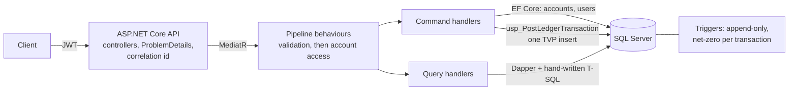

# LedgerCore

A double-entry wallet and payment ledger API: accounts hold money, every movement is an immutable pair of ledger entries that nets to zero, and the database itself refuses anything that would break that.

[](https://github.com/aymankuy/LedgerCore/actions/workflows/ci.yml)

**Live demo:** _coming in Phase 5 (Azure App Service)_ · **Swagger:** `http://localhost:8080/swagger` after the quick start below

## Architecture



The write side goes through EF Core and a stored procedure; the read side is Dapper over plain SQL. Domain ← Application ← Infrastructure ← Api, with dependencies pointing inward only.

## Why I built this

Moving money looks like simple arithmetic until two requests touch the same balance at the same moment, a client retries a request that already succeeded, or a bug writes half a transaction. LedgerCore is my answer to those problems with the guarantees pushed down into the database: no stored balance that can drift, ledger rows that cannot be updated or deleted, and transactions that are rejected unless they net to exactly zero. Phase 2 adds the concurrency side: locking, idempotency keys and deadlock-safe transfers, each proven by tests against a real SQL Server.

## Tech stack


## Quick start

Requires Docker.

```bash
docker compose up --build
```

Then open **http://localhost:8080/swagger**. On first start the API migrates the database, creates a least-privilege SQL login for itself, and seeds demo data.

| User | Password | Notes |
|---|---|---|
| `alice@demo.local` | `demo-password` | EUR account with 925.00 |
| `bob@demo.local` | `demo-password` | EUR account with 325.00 |
| `admin@ledgercore.local` | `admin-local-only` | Admin: may read any account |

In Swagger: call `POST /api/auth/login`, copy the `token`, click **Authorize** and paste it. Every other `POST` needs an `Idempotency-Key` header: any unique value, such as a new GUID. These credentials are local-only defaults (see [ADR 0004](docs/decisions/0004-local-compose-credentials.md)); override them in a `.env` file. SQL Server is reachable from the host on `localhost,14333`.

### Endpoints

| Method | Path | |
|---|---|---|
| POST | `/api/auth/register`, `/api/auth/login` | Sign up, get a JWT |
| GET / POST | `/api/accounts` | List your accounts with balances / open one |
| GET | `/api/accounts/{id}/balance` | Balance derived from the ledger |
| GET | `/api/accounts/{id}/statement?from=&to=` | Entries with running balance, default last 30 days |
| POST | `/api/accounts/{id}/deposits`, `/withdrawals` | Money in and out through the settlement account |
| POST | `/api/transfers` | Between customer accounts; the sender also pays the currency's transfer fee |
| POST | `/api/accounts/{id}/freeze`, `/unfreeze` | Admin only: block or allow money movements on an account |

Every write except login requires an `Idempotency-Key` header. Sending the same key again returns the first response without running the request twice; the same key with a different request returns 409. Keys are per user.

Errors are RFC 7807 ProblemDetails with a stable `code` and the request's `correlationId`: 400 invalid input, 401 not authenticated, 404 not found **or not yours**, 409 conflict, 422 business rule (for example `insufficient_funds`).

### Running the tests

```bash
dotnet test
```

Integration tests start SQL Server 2022 in Docker through Testcontainers. In-memory providers are not used anywhere, because they do not reproduce triggers, constraints or locking.

To check that the concurrency tests do not flake, run them 20 times in a row (about five minutes): `scripts/repeat-concurrency-tests.sh`.

## Concurrency: before and after

In Phase 1, withdrawals and transfers were deliberately naive: they read the balance with no lock and no transaction. Phase 2 first wrote tests that fire requests in parallel against a real SQL Server 2022 (Testcontainers), ran them against the naive code, and only then fixed it. Each failure below is real output from those runs.

| Test | Before the fix | After |
|---|---|---|
| 100 parallel withdrawals of 10 from a balance of 100 | 12 to 15 succeeded, balance **-20 to -50** | exactly 10 succeed, balance 0 |
| 50 transfers A→B and 50 B→A at the same time | with the source locked first, a **deadlock** reached the caller in 3 of 3 runs | all 100 succeed, totals unchanged |
| A forced deadlock between two transactions | the victim's caller got SQL error 1205 | the victim is retried and both commit |
| The same `Idempotency-Key` sent 50 times in parallel | the retries **drained the account**: 10 withdrawals ran | money moves once, all 50 get the same transaction id |
| 20 parallel freezes of one account | **2 succeeded**, one silently overwriting the other | exactly 1 succeeds, the rest get 409 or 422 |

The fixed suite passes 20 consecutive runs (`scripts/repeat-concurrency-tests.sh`).

```text
Naive withdrawals:
  Expected balance.Balance to be 0M because the balance must never go below zero,
  but found -50.0000M (difference of -50.0000).

Transfers locking the source first:
  SqlException : Transaction (Process ID 96) was deadlocked on lock resources with
  another process and has been chosen as the deadlock victim. Rerun the transaction.
```

**What fixed each one:**

- **Overdrawn balance:** each money movement runs in one `READ COMMITTED` transaction and first locks the debited account row `WITH (UPDLOCK, HOLDLOCK)`. A parallel request on the same account waits, then reads a balance that includes the first one ([ADR 0002](docs/decisions/0002-isolation-level.md)).
- **Reciprocal deadlock:** a transfer locks both accounts, always the lower id first, so two transfers in opposite directions queue on the same row instead of each holding one lock.
- **Deadlocks nobody predicted:** a Polly retry runs the whole transaction again on error 1205, up to three times with exponential backoff and jitter.
- **Duplicate retries:** the key is claimed in the same transaction as the money movement. A parallel duplicate waits on the key's row and then returns the stored response ([ADR 0005](docs/decisions/0005-idempotency-keys.md)).
- **Lost status update:** freezing an account is rare, so it takes no lock; EF Core checks `Accounts.RowVersion` in the `UPDATE` and a conflict becomes a 409.

The first run surfaced a bug nobody was looking for. Before any balance logic was involved, the tests deadlocked inside the Phase 1 net-zero trigger, which scanned an index and waited on other transactions' uncommitted rows. A covering index and a seek-only trigger fixed it ([ADR 0001](docs/decisions/0001-net-zero-enforcement.md), amendment).

## Performance

_Phase 4._ Statement query on a hot account at 10 million ledger entries, before and after indexing.

## Design decisions

| Decision | Why, in one sentence |
|---|---|
| No `Balance` column | A balance derived from the ledger cannot drift from the ledger. |
| Append-only trigger plus `DENY UPDATE, DELETE` | Corrections must be new reversing entries, and the database enforces it even against a buggy caller. |
| Net-zero trigger, entries posted by one stored procedure with a TVP | The rule spans rows, so a `CHECK` cannot express it, and EF's batching is not a guarantee ([ADR 0001](docs/decisions/0001-net-zero-enforcement.md)). |
| Least-privilege application login | Without `ALTER` it cannot `TRUNCATE` ledger entries, which would bypass the triggers. |
| `Accounts.Kind` (customer / settlement) | Deposits and withdrawals need a counterpart account so they still net to zero ([ADR 0003](docs/decisions/0003-account-kind.md)). |
| CQRS: EF Core writes, Dapper reads | Writes need change tracking and transactions; reads such as the running-balance statement are better written as T-SQL. |
| MediatR pipeline behaviours | Validation, the "only your own accounts" rule and idempotency run once for every request, so no controller can forget them. |
| Pessimistic lock for money, optimistic `RowVersion` for status | Movements on one account are frequent and must queue; status changes are rare, so a conflict check is cheaper than a lock. |
| Polly retry on deadlock (error 1205) | Lock ordering prevents the deadlocks we know about; the retry covers the ones we do not. |
| Repository + Unit of Work on the write side only | They group a command's changes into one commit; wrapping Dapper queries in repositories would add nothing. |
| Not found instead of forbidden for other users' accounts | Account ids cannot be probed to learn which ones exist. |
| ProblemDetails with a correlation id | Clients get a stable error shape, and a support request can be matched to the logs without exposing internals. |

## Power BI report

_Phase 6._
