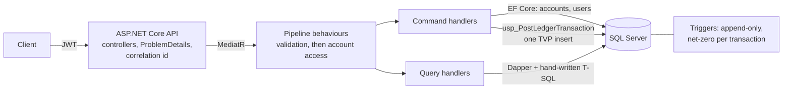

# LedgerCore

A double-entry wallet and payment ledger API: accounts hold money, every movement is an immutable pair of ledger entries that nets to zero, and the database itself refuses anything that would break that.

[](https://github.com/aymankuy/LedgerCore/actions/workflows/ci.yml)

**Live demo:** _coming in Phase 5 (Azure App Service)_ · **Swagger:** `http://localhost:8080/swagger` after the quick start below

## Architecture



The write side goes through EF Core and a stored procedure; the read side is Dapper over plain SQL. Domain ← Application ← Infrastructure ← Api, with dependencies pointing inward only.

## Why I built this

Moving money looks like simple arithmetic until two requests touch the same balance at the same moment, a client retries a request that already succeeded, or a bug writes half a transaction. LedgerCore is my answer to those problems with the guarantees pushed down into the database: no stored balance that can drift, ledger rows that cannot be updated or deleted, and transactions that are rejected unless they net to exactly zero. Phase 2 adds the concurrency side: locking, idempotency keys and deadlock-safe transfers, each proven by tests against a real SQL Server.

## Tech stack


## Quick start

Requires Docker.

```bash
docker compose up --build
```

Then open **http://localhost:8080/swagger**. On first start the API migrates the database, creates a least-privilege SQL login for itself, and seeds demo data.

| User | Password | Notes |
|---|---|---|
| `alice@demo.local` | `demo-password` | EUR account with 925.00 |
| `bob@demo.local` | `demo-password` | EUR account with 325.00 |
| `admin@ledgercore.local` | `admin-local-only` | Admin: may read any account |

In Swagger: call `POST /api/auth/login`, copy the `token`, click **Authorize** and paste it. These credentials are local-only defaults (see [ADR 0004](docs/decisions/0004-local-compose-credentials.md)); override them in a `.env` file. SQL Server is reachable from the host on `localhost,14333`.

### Endpoints

| Method | Path | |
|---|---|---|
| POST | `/api/auth/register`, `/api/auth/login` | Sign up, get a JWT |
| GET / POST | `/api/accounts` | List your accounts with balances / open one |
| GET | `/api/accounts/{id}/balance` | Balance derived from the ledger |
| GET | `/api/accounts/{id}/statement?from=&to=` | Entries with running balance, default last 30 days |
| POST | `/api/accounts/{id}/deposits`, `/withdrawals` | Money in and out through the settlement account |
| POST | `/api/transfers` | Between customer accounts |

Errors are RFC 7807 ProblemDetails with a stable `code` and the request's `correlationId`: 400 invalid input, 401 not authenticated, 404 not found **or not yours**, 409 conflict, 422 business rule (for example `insufficient_funds`).

### Running the tests

```bash
dotnet test
```

Integration tests start SQL Server 2022 in Docker through Testcontainers. In-memory providers are not used anywhere, because they do not reproduce triggers, constraints or locking.

## Concurrency: before and after

_Phase 2._ Withdrawals and transfers are deliberately naive in Phase 1 (the balance is read without a lock), so that the Phase 2 concurrency tests can show the naive version failing before the fix.

## Performance

_Phase 4._ Statement query on a hot account at 10 million ledger entries, before and after indexing.

## Design decisions

| Decision | Why, in one sentence |
|---|---|
| No `Balance` column | A balance derived from the ledger cannot drift from the ledger. |
| Append-only trigger plus `DENY UPDATE, DELETE` | Corrections must be new reversing entries, and the database enforces it even against a buggy caller. |
| Net-zero trigger, entries posted by one stored procedure with a TVP | The rule spans rows, so a `CHECK` cannot express it, and EF's batching is not a guarantee ([ADR 0001](docs/decisions/0001-net-zero-enforcement.md)). |
| Least-privilege application login | Without `ALTER` it cannot `TRUNCATE` ledger entries, which would bypass the triggers. |
| `Accounts.Kind` (customer / settlement) | Deposits and withdrawals need a counterpart account so they still net to zero ([ADR 0003](docs/decisions/0003-account-kind.md)). |
| CQRS: EF Core writes, Dapper reads | Writes need change tracking and transactions; reads such as the running-balance statement are better written as T-SQL. |
| MediatR pipeline behaviours | Validation and the "only your own accounts" rule run once for every request, so no controller can forget them. |
| Repository + Unit of Work on the write side only | They group a command's changes into one commit; wrapping Dapper queries in repositories would add nothing. |
| Not found instead of forbidden for other users' accounts | Account ids cannot be probed to learn which ones exist. |
| ProblemDetails with a correlation id | Clients get a stable error shape, and a support request can be matched to the logs without exposing internals. |

## Power BI report

_Phase 6._
