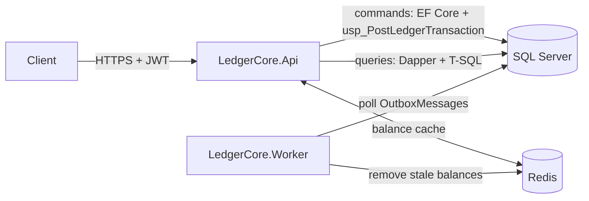
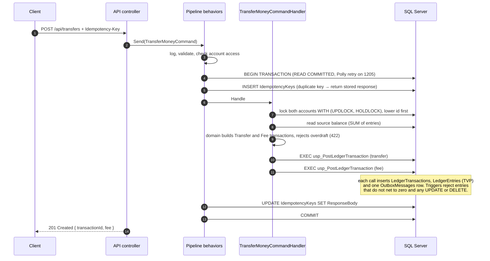
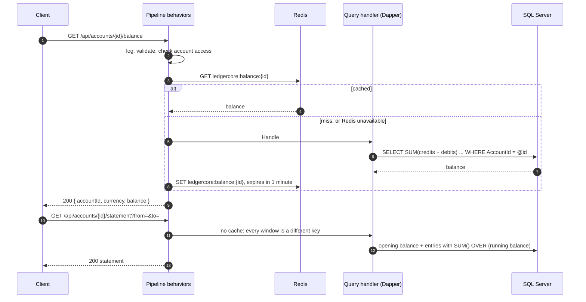
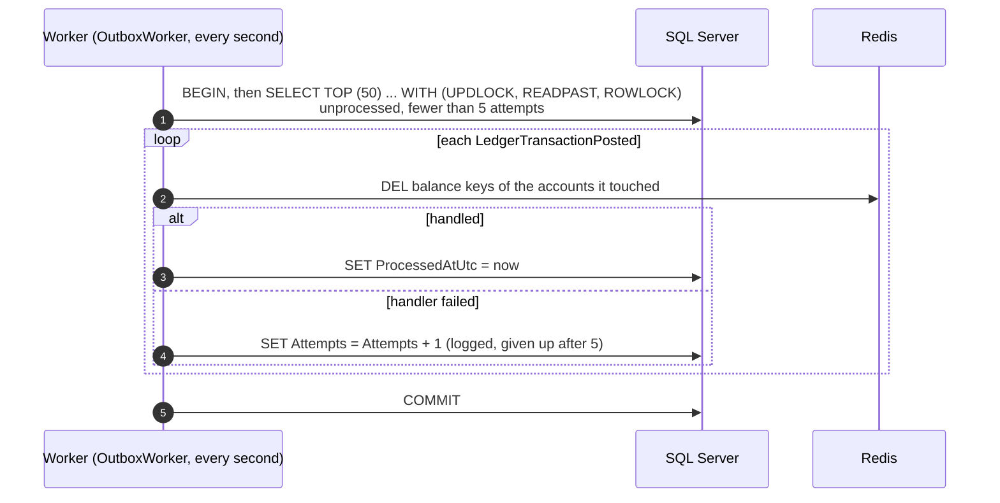

# Architecture

LedgerCore is two deployables over one SQL Server database: the **API**, which takes requests, and
the **Worker**, which reacts to what the API has committed. Redis is a cache in front of balance
reads, never a source of truth.

Projects depend inward only: Domain ← Application ← Infrastructure ← Api / Worker. Application
holds the commands, queries and pipeline behaviors, and knows SQL Server and Redis only through
interfaces (`IUnitOfWork`, `IDbConnectionFactory`, `ICache`).

## Every request: the MediatR pipeline

Each controller action sends one command or query through MediatR. The behaviors wrap the handler
like decorators, in this order:

| # | Behavior | Applies to | What it does |
|---|---|---|---|
| 1 | `LoggingBehavior` | everything | One structured log line: request name, duration, outcome. Never the payload. |
| 2 | `ValidationBehavior` | everything | FluentValidation; a failure is a 400 before anything touches the database. |
| 3 | `AccountAccessBehavior` | `IAccountScopedRequest` | A user may only touch their own accounts; others get a 404, as if the account did not exist. |
| 4 | `CachingBehavior` | `ICacheableQuery` | Serves the balance from Redis, or runs the query and stores it. |
| 5 | `TransactionBehavior` | `ICommand` | Opens the `READ COMMITTED` transaction, retried as a whole on a deadlock. |
| 6 | `IdempotencyBehavior` | `IIdempotentCommand` | Claims the `Idempotency-Key` inside that transaction, or returns the stored response. |

Caching runs after the access check, so a cached balance is only returned to a caller allowed to
read it. Only queries can be cacheable, so no command ever reads a cached balance.

## Write path: a transfer

Commands go through EF Core and one stored procedure, inside a single database transaction. Every
step from claiming the idempotency key to writing the outbox event commits or rolls back together.

Why it is built this way:

- **The lock, not the isolation level, prevents overdrafts.** Two withdrawals on one account queue
  on the account row; the second reads a balance that includes the first
  ([ADR 0002](decisions/0002-isolation-level.md)).
- **Lock order prevents reciprocal deadlocks.** A→B and B→A both lock the lower id first.
- **The fee is a second ledger transaction in the same database transaction**, so a transfer never
  commits without its fee, and fee revenue is an ordinary account that the ledger can sum.
- **The idempotency key is claimed in the same transaction**, so a parallel duplicate waits on the
  key row and then replays the first response ([ADR 0005](decisions/0005-idempotency-keys.md)).

## Read path: balance and statement

Queries skip EF Core and the repositories. They are hand-written T-SQL run through Dapper, because
the statement's running balance is a window function, which is clearer and faster in SQL than in
LINQ. The tables they read are the read model for now; Phase 4 adds a balance snapshot table, so a
balance read no longer sums the whole history.

If Redis is down, the client fails fast and the query is answered from SQL Server; a cache outage
costs no latency and no correctness.

## After the commit: outbox and Worker

The event that says "these accounts changed" is written by `usp_PostLedgerTransaction` in the same
transaction as the ledger entries. The Worker picks it up afterwards.

- **Several Workers can run at once.** Each claims its batch with `UPDLOCK`, and `READPAST` makes
  the others skip those rows instead of waiting. Without the hints, four parallel dispatchers
  deadlocked in each of three runs; with them, 500 messages are each handled exactly once.
- **Delivery is at least once.** If the Worker dies after a handler ran but before the commit, the
  message is handled again. Handlers must therefore be safe to repeat; removing a cache key is.
- **The Worker also deletes idempotency keys older than 24 hours**, 1,000 rows per statement, once
  an hour ([ADR 0006](decisions/0006-background-jobs-without-hangfire.md)).

### Why not just write to the database and then to Redis?

Without the outbox, the API would commit the ledger entries and then clear the cache itself: two
writes to two systems with no transaction spanning both. If the process crashes, is redeployed or
loses Redis between the two, the commit stands and the cache keeps the old balance, with nothing
left anywhere to show that a clean-up is owed. Doing it the other way round is no better: clear
first, and a reader can refill the cache with the old balance before the commit. The outbox turns
"also tell the others" into a row in the same transaction as the money movement, so it exists if
and only if the money moved, and the Worker retries it until it succeeds. The same holds for any
future consumer, such as a message broker or the Phase 6 warehouse load.

The one-minute expiry on cached balances bounds the remaining race: a slow reader that loaded the
old balance just before the commit can still store it after the Worker cleared the key.
