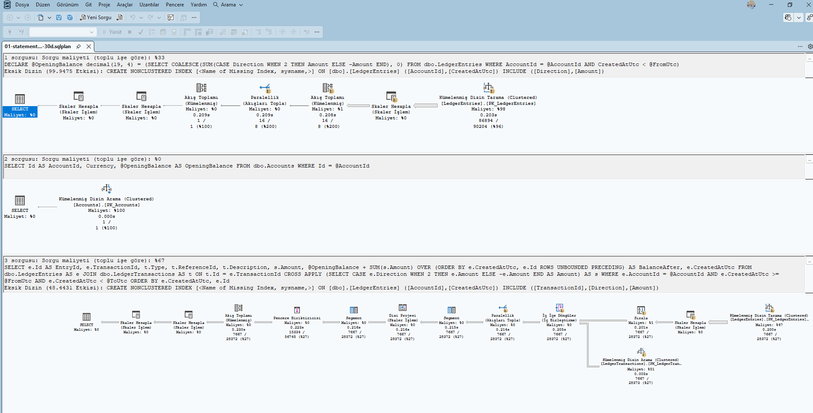
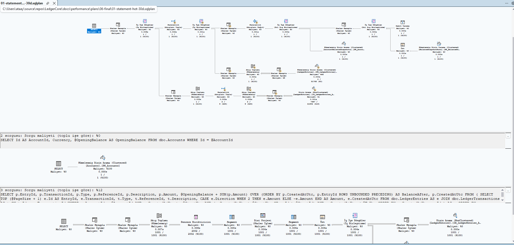
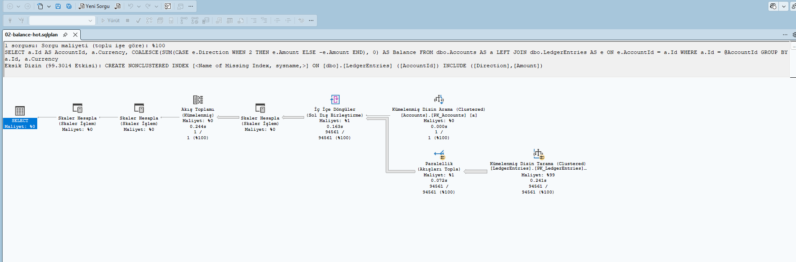
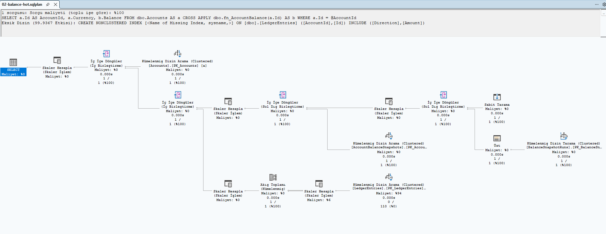

# Performance at 10 million ledger entries

Phase 4 of the spec sets one hard target: **a 30-day statement for a hot account in under
50 ms at 10M rows.** This page shows how each key query performed before and after the work,
measured rather than estimated. Each step links to the decision record that explains it.

**Result: the target is met.** At the largest allowed page size, the statement takes 17.5 ms
(warm median). Balance reads went from 226 ms to 1.1 ms.

## How it was measured

| | |
|---|---|
| Machine | Intel Core i7-12650H (10 cores, 16 threads), 32 GB RAM, Windows 11 Pro |
| Database | SQL Server 2022 Developer Edition CU27, in Docker Desktop 29.8 on WSL 2. The container sees 16 CPUs and 12.4 GB of memory. Default `max server memory` and parallelism settings. |
| Data | 10,000,006 ledger entries in 5M transactions over one year, and 50,008 accounts. Generated by `tools/LedgerCore.DataGenerator` with a fixed seed: about 50,000 customers, 20 hot accounts that carry 30% of the traffic, and a long tail with a median of 58 entries per account. |
| Hot account | 94,561 entries, of which 7,667 fall in the 30-day window |
| Runs | For each query: one cold run after `CHECKPOINT; DBCC DROPCLEANBUFFERS`, then 3 warm-up runs, then 20 timed warm runs. The table shows the warm median. |
| Timing | End to end from a .NET client on the same machine, including reading every row. Logical reads come from `SET STATISTICS IO`. |

To repeat a run: `dotnet run -c Release --project tools/LedgerCore.DataGenerator -- benchmark --label <name>`.
The tool writes a results table to `docs/performance/<name>.md` and the actual plans to
`docs/performance/plans/<name>/`. The queries it runs are in
[tools/LedgerCore.DataGenerator/Benchmarks](../tools/LedgerCore.DataGenerator/Benchmarks).

## Before and after

Before is the Phase 3 schema loaded with 10M entries ([01-baseline](performance/01-baseline.md)).
After is the end of Phase 4 ([06-final](performance/06-final.md)).

| Query | Before | After | Logical reads before → after |
|---|---:|---:|---:|
| Statement, hot account, 30 days | 508.7 ms (7,667 lines) | **17.5 ms** (first page, 1,000 lines) | 233,947 → 4,164 |
| Balance, hot customer account | 226.2 ms | **1.1 ms** | 101,333 → 12 |
| Balance, EUR settlement account (1.36M entries) | 1,187.4 ms | **1.1 ms** | 100,885 → 12 |
| Account list with balances | 126.6 ms | **1.3 ms** | 284,214 → 15 |
| Report: daily volume, 30 days | 612.6 ms | 467.0 ms | 197,097 → 176,280 |
| Report: top 10 accounts, 30 days | 351.4 ms | 230.4 ms | 103,244 → 81,377 |

The report rows start from [02-procedures](performance/02-procedures.md), because the
reports were added in that step. No index was added for them, on purpose (see step 3).

Cold runs, with the buffer pool emptied first, are slower: the statement page takes 194 ms and
a balance read 16 ms. That cost is reading from disk, and a hot account's pages rarely leave
the cache. The full cold numbers are in each linked table.

## Step by step

Warm medians in ms, with each step's decision record linked.

| Step | Statement | Hot balance | Settlement balance | Account list |
|---|---:|---:|---:|---:|
| [1. Baseline](performance/01-baseline.md) | 508.7 | 226.2 | 1,187.4 | 126.6 |
| [2. Stored procedures and one balance function](performance/02-procedures.md) | 478.0 | 222.9 | 263.0 | 120.8 |
| [3. Covering index](performance/03-indexes.md) ([ADR 0008](decisions/0008-ledger-entry-indexes.md)) | 85.6 | 22.0 | 33.2 | 20.3 |
| [4. Balance snapshots](performance/04-snapshots.md) ([ADR 0009](decisions/0009-balance-snapshots.md)) | 57.7 | 1.2 | 1.1 | 1.1 |
| [5. Keyset-paged statement](performance/05-paged-statement.md) ([ADR 0010](decisions/0010-keyset-paged-statement.md)) | 18.0 | 1.1 | 1.0 | 1.2 |
| [6. Each subquery evaluated once](performance/06-final.md) | 17.5 | 1.1 | 1.1 | 1.3 |

1. **Baseline.** Every per-account read scanned the whole `LedgerEntries` table. The only
   index on `AccountId` had no other columns, so a hot account would have needed 94,561 key
   lookups. The optimizer read all 101,333 pages instead.
2. **Stored procedures.** The statement and reports moved into procedures, and all balance
   reads now go through one inline function, `fn_AccountBalance`. Most times barely moved,
   because the scans were still there. The settlement balance is the exception: the
   function's plan aggregates the scan in parallel, per thread. This step set up the next ones.
3. **Covering index.** `(AccountId, CreatedAtUtc, Id)` includes `Direction`, `Amount` and
   `TransactionId`. Every per-account read became one seek, with no lookups and no sort.
   Clustering the table by account was measured and rejected: reads were no faster, and
   inserts were 22% slower. A date index for the reports was measured and rejected too: the
   gain was modest for 613 MB of extra storage on admin-only queries.
4. **Balance snapshots.** A balance is now the snapshot plus the entries after a watermark,
   and the Worker refreshes the snapshots every minute. A read no longer depends on how long
   the account's history is. The statement's opening balance became cheap as well, but the
   statement still returned 7,667 lines, at 57.7 ms.
5. **Keyset paging.** Of the 57.7 ms, about 16 went to reading and sending 7,667 lines, 29 to
   looking up their transactions, and 12 to the running balance. Pages of at most 1,000 lines,
   with a `(CreatedAtUtc, EntryId)` cursor, bring every page under the target. The last page
   costs about the same as the first.
6. **One evaluation per subquery.** The actual plans showed that `COALESCE((subquery), 0)` ran
   every balance subquery twice. `ISNULL` runs it once. This matters most when the snapshots
   lag: 100,000 entries behind the watermark, a balance read fell from 16.4 ms to 7.3 ms.

### Other paging cases (step 5)

| Page | Warm median | Logical reads |
|---|---:|---:|
| First page, 100 lines (the API default) | 12.0 ms | 577 |
| Last page of the window, 1,000-line pages | 14.2 ms | 2,823 |
| First page of a 30-day window a year back | 27.7 ms | 5,668 |

The year-old window is the slowest case. Its opening balance is the current balance minus
nearly the whole history after the window's start.

### When the snapshots fall behind (step 6)

| Entries behind the watermark | Hot balance | Logical reads |
|---:|---:|---:|
| 0 | 1.1 ms | 12 |
| 1,000 | 1.3 ms | 20 |
| 10,000 | 1.7 ms | 94 |
| 100,000 | 7.3 ms | 834 |

This data set posts about 19 entries a minute, so with a one-minute refresh a read normally
sits on the first row of this table.

## Execution plans

The actual plans, as `.sqlplan` files, are in `docs/performance/plans/<step>/`. They open in
SSMS or Azure Data Studio.

### Statement, before

Two parallel clustered index scans of all 10M entries. One sums everything before the window
for the opening balance; the other finds the window's lines and sorts them. File:
[01-baseline/01-statement-hot-30d.sqlplan](performance/plans/01-baseline/01-statement-hot-30d.sqlplan).

### Statement, after

The opening balance takes three short reads: the latest run, the account's snapshot row, and
a seek for the entries after the watermark. A seek on the covering index then subtracts the
entries from the window's start onwards. The page itself is a seek on the covering index, in
statement order. It feeds a nested-loop join to `LedgerTransactions`, and `Top` stops that
join after 1,001 rows, so only the page's lines are looked up. There is no sort. File:
[06-final/01-statement-hot-30d.sqlplan](performance/plans/06-final/01-statement-hot-30d.sqlplan).

### Balance, before

A parallel scan of the whole clustered index, for one account. File:
[01-baseline/02-balance-hot.sqlplan](performance/plans/01-baseline/02-balance-hot.sqlplan).

### Balance, after

Three seeks with a total of 12 logical reads: the latest `BalanceSnapshotRuns` row, the
`AccountBalanceSnapshots` row, and the range of `LedgerEntries` after the watermark. File:
[06-final/02-balance-hot.sqlplan](performance/plans/06-final/02-balance-hot.sqlplan).

### SSMS's missing-index suggestions

- **Before plans:** SSMS suggests an index on `(AccountId, CreatedAtUtc)` including
  `Direction` and `Amount`. That is the covering index step 3 added.
- **Final balance plan:** SSMS suggests an index on `(AccountId, Id)`. It was considered and
  rejected ([ADR 0009](decisions/0009-balance-snapshots.md)). The plan already reads only
  12 pages, and the index would be about 450 MB more that every insert must maintain. The
  entries after the watermark are already at the end of the clustered index on `Id`.

## What was not optimized

- **The reports** still read about 80,000–180,000 pages. They are admin-only and run rarely,
  and the Phase 6 warehouse is where reporting belongs. An index for them was measured and not
  adopted ([ADR 0008](decisions/0008-ledger-entry-indexes.md)).
- **`IX_LedgerEntries_TransactionId`** takes 1,007 MB before a rebuild and 615 MB after one.
  Its key is a random GUID, so its pages settle at 60–70% full. Reclaiming that space is
  routine index maintenance and is not part of the schema.
